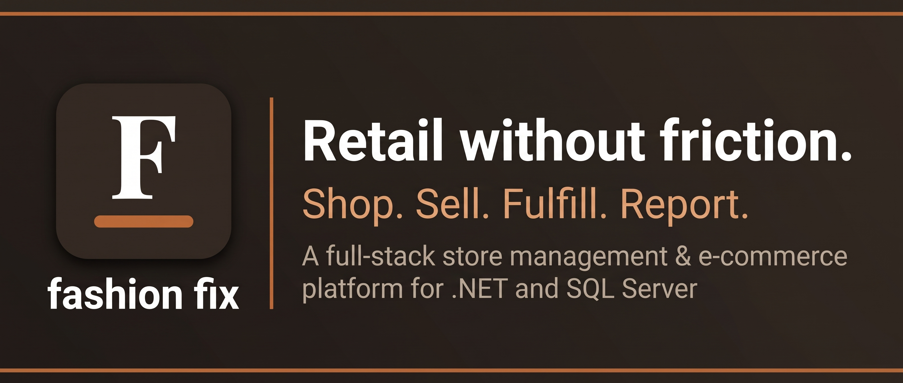

<div align="center">



<br /><br />

<p>
  A full-stack ASP.NET Core MVC and SQL Server retail platform unifying an online customer storefront,<br />
  in-store Point of Sale, Paystack checkout, inventory control, and dynamic role-based permissions.
</p>

<p>
  
  
  <a href=https://versionsof.net/core/8.0/8.0.25/>
  
  </a>
  <a href =https://www.microsoft.com/en-za/sql-server/sql-server-downloads>
  
  </a>
  <a href=https://paystack.com/docs/api/>
  
  </a>
  <a href="www.linkedin.com/in/okuhle-malishe-6b6994410">
    
  </a>
</p>

</div>

---

## What Fashion Fix Can Do

Fashion Fix operates as an all-in-one fashion retail system connecting online shoppers and in-store staff to a single, synchronized inventory and order backend.

### Customer Storefront & Online Checkout
- **Catalogue & Shopping Cart:** Customers can browse available apparel, filter products, and manage session-backed shopping carts.
- **Verified Paystack Payments:** Checkout initializes a live Paystack transaction (test mode), redirects shoppers to Paystack's hosted payment page, and verifies payment **server-side** via callback before creating an order, deducting inventory, and dispatching a confirmation email.
- **Self-Service Account & Order Tracking:** Customers can self-register, track order progress in real time, cancel eligible orders (automatically restocking items), and manage their details under **My Profile**—including a visible **Customer ID** they can share with cashiers at the till.

### In-Store Point of Sale (POS)
- **Dedicated Physical Sales Channel:** Built as a full second sales channel alongside the web store (`PosController`) for walk-in transactions.
- **Fast Till Workflow:** Supports barcode/SKU lookup with an image preview popup, real-time cart calculation, and receipt generation with an optional emailed copy.
- **Tamper-Proof Tax Calculation:** Automatically computes **15% VAT** strictly server-side (`Security/TaxSettings.cs`) so tax totals can never be manipulated from the client.

### Inventory, Fulfillment & Returns
- **Product Catalogue Management:** Full CRUD controls for inventory items with search, filtering, and customizable low-stock thresholds.
- **End-to-End Order Fulfillment:** Staff move online orders smoothly across the fulfillment pipeline (`Processing → Shipped → Delivered`) or cancel orders with instant automated stock restoration.
- **Returns & Supplier Operations:** Process customer returns directly back into live stock, manage supplier records, and track purchase orders.

### Security, Roles & Staff Management
- **Dual Login Portals:** Separates customer storefront authentication from a dedicated **Employee Login** portal, backed by ASP.NET Core Identity and persistent Data Protection keys so sessions survive restarts.
- **Runtime-Configurable RBAC:** Ships with five default roles (`Administrator`, `Manager`, `Employee`, `Customer`, `Owner`), but every role is a dynamic bundle of permissions editable live from **Roles & Permissions** (Admin only)—letting admins create custom roles without touching code or redeploying.
- **Employee Onboarding & Audit Trail:** Staff creation includes input validation, duplicate checks, role assignment, and automatic audit log entries tracking key administrative actions.

### Dashboard, Analytics & Notifications
- **Live Store Dashboard:** Displays real-time operational stats alongside active low-stock alerts.
- **Reporting & Exports:** Generates business reports with one-click **CSV export**.
- **Audio-Visual Feedback:** Every user action triggers an on-screen toast notification paired with its own subtle audio cue.
- **Genuine SMTP Email Engine:** Sends real transactional emails (receipts, order status updates, and cancellations) via any standard SMTP provider (Gmail, Outlook, Zoho), and gracefully no-ops when unconfigured so local development never breaks.

---

## Tech Stack

| Layer | Technologies |
| --- | --- |
| **Backend** | C#, ASP.NET Core MVC (.NET 8), Entity Framework Core, ASP.NET Core Identity |
| **Database** | SQL Server |
| **Integrations** | Paystack API (Test Mode), SMTP Email |
| **Frontend** | Razor Views, Bootstrap, JavaScript |
| **Tooling & Testing** | EF Core CLI, Postman API Test Collection, Python HTTP Seeder |

---

## Quick Start

1. **Configure Connections & Keys**
   Update `appsettings.json` (or use `dotnet user-secrets`) with your SQL Server connection string (`ConnectionStrings:DefaultConnection`), Paystack test keys, and optional SMTP credentials.

2. **Restore & Run**
   Database migrations, default roles, and the initial admin account apply automatically on startup:
   ```bash
   dotnet restore
3.First Admin Login (via Employee Login — change immediately)

Username: admin

Password: Ch4ngeMe!Now
   dotnet run
